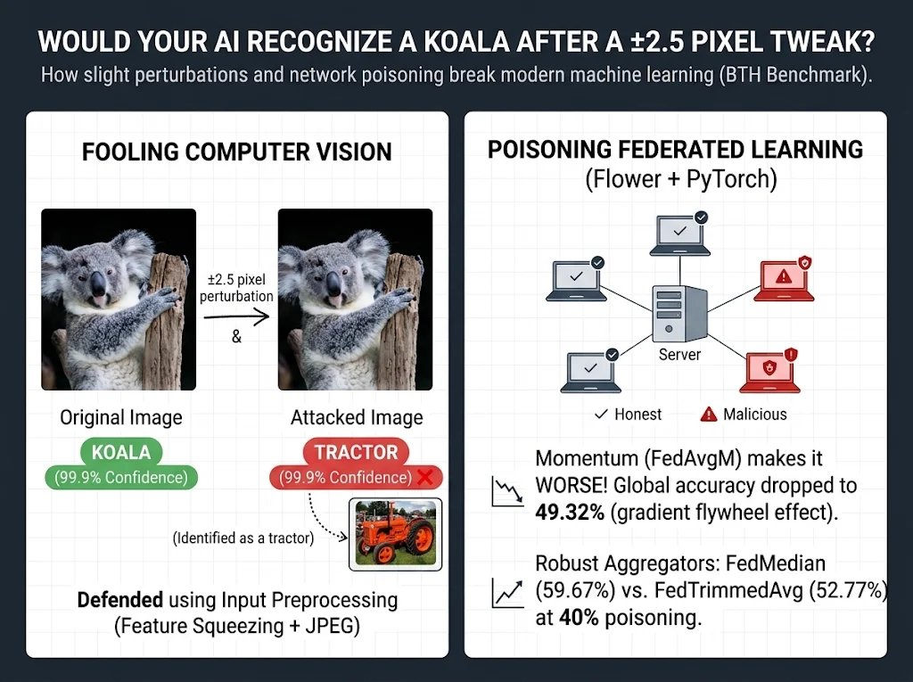
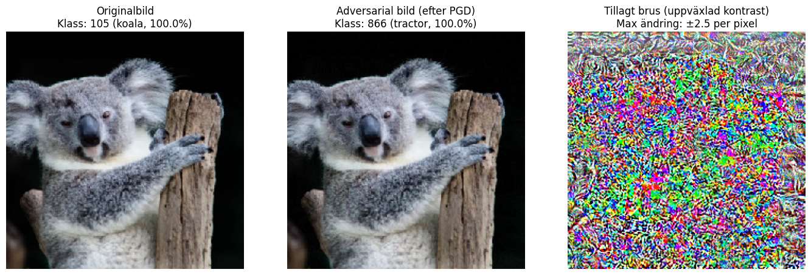
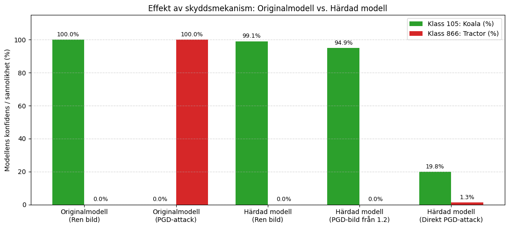
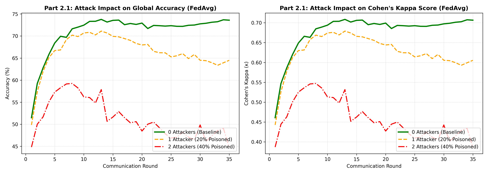
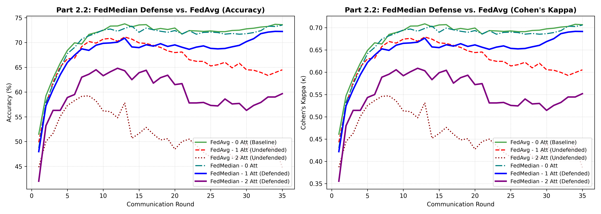
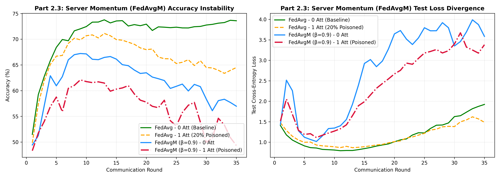
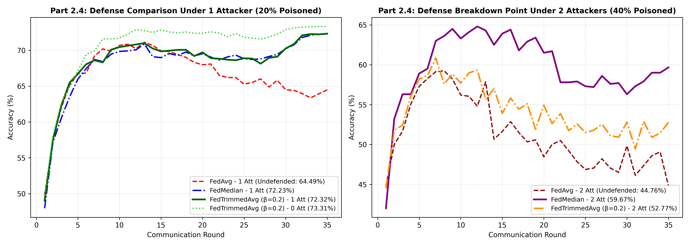

# Security in AI Systems: Adversarial Evasion & Byzantine-Robust Federated Learning

[](https://www.python.org/)
[](https://pytorch.org/)
[](https://flower.ai/)
[](https://www.tensorflow.org/)
[](https://github.com/Trusted-AI/adversarial-robustness-toolbox)



An end-to-end empirical investigation into **Adversarial Machine Learning** and **Federated Learning Security**, developed as part of *DV2607: Security in AI Systems* at **Blekinge Institute of Technology (BTH)**.

This project explores how modern AI systems fail under adversarial manipulation—both at **inference time** (centralized white-box evasion attacks) and at **training time** (distributed data poisoning in Federated Learning)—and implements practical, mathematically grounded defenses to harden them.

---

## Key Highlights & Engineering Takeaways

| Module | Threat Model & Attack | Defense Engineered | Key Empirical Result |
| :--- | :--- | :--- | :--- |
| **Part 1: Centralized Vision Security** | White-box Targeted **Projected Gradient Descent (PGD)** against ImageNet **ResNet-50** | Multi-stage Input Sanitization: **Feature Squeezing (4-bit)** + **JPEG Compression (Q=60)** | Neutralized 100%-confident *Tractor* misclassification back to **94.9% *Koala*** with **0% clean accuracy penalty** and no retraining required. |
| **Part 2: Federated Learning Security** | Distributed **Label-Flipping Data Poisoning** ($y' = 9 - y$) across 20% and 40% compromised FL clients | Byzantine-Robust Aggregation: **Coordinate-wise Median (`FedMedian`)** & **Trimmed Mean (`FedTrimmedAvg`, $\beta=0.2$)** | Restored global accuracy from **64.49% $\to$ 72.32%** (at 20% poisoned) and prevented network collapse (**44.76% $\to$ 59.67%** at 40% poisoned). Demonstrated why Server Momentum (`FedAvgM`) worsens poisoning. |

---

## Repository Structure

```text
Security-in-AI-systems/
├── README.md                                                     # Project overview, architecture & empirical benchmarks
├── requirements.txt                                              # Python dependencies
├── notebooks/
│   ├── Part1_Adversarial_Evasion_Attack_PGD.ipynb                # Part 1: ResNet-50 PGD attack & ART preprocessing defense
│   └── Part2_Federated_Learning_Poisoning_and_Defense.ipynb      # Part 2: 11 Flower FL simulations (FedAvg, FedMedian, FedAvgM, FedTrimmedAvg)
├── images/
│   ├── project_overview_banner.jpg                               # Visual overview banner (Computer Vision + Federated Learning)
│   ├── part1_pgd_attack_visualization.png                        # Visual comparison: Clean vs. PGD Adversarial vs. Noise
│   ├── part1_defense_evaluation.png                              # Confidence comparison: Undefended vs. Defended ResNet-50
│   ├── part2_1_attack_impact.png                                 # Part 2.1: FedAvg under 0, 1 (20%), and 2 (40%) attackers
│   ├── part2_2_fedmedian_defense.png                             # Part 2.2: FedMedian defense vs. undefended FedAvg
│   ├── part2_3_fedavgm_momentum.png                              # Part 2.3: Server Momentum (FedAvgM) instability & poison retention
│   ├── part2_4_trimmed_mean_defense.png                          # Part 2.4: FedTrimmedAvg vs. FedMedian breakdown analysis
│   ├── koala.jpeg                                                # Source image (ImageNet class 105: Koala)
│   └── tractor.jpeg                                              # Target class reference (ImageNet class 866: Tractor)
└── report/
    └── Rapport_DV2607_Bilal_Subhi.pdf                            # Full technical report (PDF)
```

---

## Part 1: Centralized Evasion Attack & Input Preprocessing Defense

### 1.1 Targeted PGD Attack on ResNet-50
We target a pretrained **ResNet-50** classifier on ImageNet (`1,000` classes) using the **Adversarial Robustness Toolbox (ART)**. Our objective is a targeted white-box evasion attack that forces the model to misclassify a clean image of a **Koala (`class 105`)** as a **Tractor (`class 866`)** while keeping the perturbation imperceptible to human observers.

Unlike single-step FGSM, **Projected Gradient Descent (PGD)** iteratively takes small gradient steps toward minimizing the loss of the target class $y_{\text{target}} = 866$ and projects the perturbed image back into an $\ell_\infty$-ball around the original input $x$:

$$x^{(t+1)} = \Pi_{\mathcal{B}_\epsilon(x)} \left( x^{(t)} - \alpha \cdot \text{sign}\left( \nabla_{x^{(t)}} \mathcal{L}(\theta, x^{(t)}, y_{\text{target}}) \right) \right)$$



* **Before Attack:** ResNet-50 predicts **Koala (105)** with **99.99% confidence** (0.00% Tractor).
* **After 15 PGD Iterations:** With a maximum pixel change of just **$\pm 2.5$ per channel** (on a $[0, 255]$ scale), ResNet-50 predicts **Tractor (866)** with **99.9% confidence**.

### 1.2 Multi-Layer Input Preprocessing Defense (`FeatureSqueezing` + `JpegCompression`)
For large pretrained foundation models where full **Adversarial Training** is computationally prohibitive, we designed a two-stage model-agnostic input sanitization pipeline executed prior to inference:
1. **Feature Squeezing (`bit_depth = 4`, `clip_values = (0, 255)`):** Quantizes the 8-bit color space (256 levels per channel) down to 4 bits (16 discrete levels), rounding away small-magnitude adversarial steps while preserving macroscopic semantic shapes.
2. **JPEG Compression (`quality = 60`):** Applies Discrete Cosine Transform (DCT) quantization, acting as a low-pass filter that strips high-frequency gradient noise introduced by PGD.



| Evaluation Scenario | Predicted Class | $P(\text{Koala}, 105)$ | $P(\text{Tractor}, 866)$ |
| :--- | :--- | :---: | :---: |
| **Original ResNet-50** on Clean Koala Image | `105 (koala)` | **99.9%** | 0.0% |
| **Original ResNet-50** on PGD Adversarial Image | `866 (tractor)` | 0.0% | **99.9%** |
| **Defended Pipeline** on Clean Koala Image | `105 (koala)` | **99.1%** | 0.0% |
| **Defended Pipeline** on PGD Adversarial Image | `105 (koala)` | **94.9%** | 0.0% |
| **Defended Pipeline** under New Adaptive PGD Attack | `105 (koala)` | **19.8%** *(Top-1)* | 1.3% |

---

## Part 2: Federated Learning Data Poisoning & Byzantine-Robust Aggregation

### 2.1 Federated Architecture & Threat Model
We simulate a decentralized Federated Learning system using **Flower (`flwr`)** and **Ray** with **PyTorch**:
* **Dataset & Partitioning:** CIFAR-10 ($50,000$ training images partitioned IID across $K = 5$ clients, $10,000$ images/client; $10,000$ unpoisoned server test images).
* **Model (`SimpleCNN`):** Two $3 \times 3$ convolutional blocks ($3 \to 32 \to 64$ filters with ReLU & $2 \times 2$ MaxPool) followed by two fully connected layers ($4096 \to 128 \to 10$).
* **Training Protocol:** $T = 35$ communication rounds, $100\%$ client participation ($5/5$ clients per round), $E = 1$ local epoch per round using SGD ($\eta = 0.01$, momentum $0.9$, batch size $32$).
* **Adversarial Attack (Label-Flipping Data Poisoning):** Compromised clients invert their local ground-truth training labels via $y_{\text{poisoned}} = 9 - y_{\text{clean}}$ (e.g., *airplane (0)* $\leftrightarrow$ *truck (9)*, *automobile (1)* $\leftrightarrow$ *ship (8)*), producing malicious gradient updates that pull global decision boundaries in the opposite direction.

---

### 2.2 Vulnerability of Standard `FedAvg` (Part 2.1)
Standard Federated Averaging (`FedAvg`) computes the unweighted mean across equal-sized clients:

$$w_{t+1} = \frac{1}{K} \sum_{k=1}^K w_{t+1}^k$$

Because the sample mean has a **breakdown point of $1/K$**, every malicious client directly biases the global model:
* **0 Attackers (Baseline):** Converges smoothly to **73.59% Accuracy** and **0.7066 Cohen's Kappa**.
* **1 Attacker (20% Poisoned):** Degrades by **$-9.10\%$** down to **64.49% Accuracy** ($\kappa = 0.6054$).
* **2 Attackers (40% Poisoned):** Collapses by **$-28.83\%$** down to **44.76% Accuracy** ($\kappa = 0.3862$).



---

### 2.3 Defense 1: Coordinate-Wise Median — `FedMedian` (Part 2.2)
Instead of averaging client weights, `FedMedian` sorts the $K = 5$ client values independently for each parameter coordinate $j$ and selects the middle (3rd) value:

$$w_{t+1, j} = \text{median}\left( \{ w_{t+1, j}^1, \dots, w_{t+1, j}^K \} \right)$$

* **Zero Benign Penalty:** With 0 attackers, `FedMedian` reaches **73.52%** (matching `FedAvg`'s **73.59%**).
* **Full 1-Attacker Recovery:** With 1 attacker (20%), `FedMedian` recovers accuracy to **72.23%** ($+7.74\%$ over `FedAvg`).
* **Resilience at 40% Poisoning:** With 2 attackers (40%), `FedMedian` maintains **59.67%** accuracy ($+14.91\%$ over `FedAvg`) thanks to its **50% theoretical breakdown point**.



---

### 2.4 Why Server Momentum (`FedAvgM`) Fails as a Defense (Part 2.3)
We evaluated **Federated Averaging with Server Momentum (`FedAvgM`)** with $\beta = 0.9$ and server learning rate $\eta_s = 1.0$:

$$v_t = \beta v_{t-1} + \Delta w_t, \quad w_{t+1} = w_t - \eta_s v_t$$

Rather than smoothing out malicious updates, `FedAvgM` **amplifies the poisoning attack**, dropping to **56.97%** with 0 attackers (after peaking at 67.22% in Round 9) and **49.32%** with 1 attacker ($-15.17\%$ worse than undefended `FedAvg`). Because $\Delta w_t$ still uses a standard mean, poisoned gradients enter the velocity vector $v_t$ and persist across future communication rounds.



---

### 2.5 Defense 2: Coordinate-Wise Trimmed Mean — `FedTrimmedAvg` (Part 2.4)
We implemented and evaluated **Coordinate-wise Trimmed Mean (`FedTrimmedAvg`)** with trim parameter $\beta = 0.2$. Across $K = 5$ clients, the server sorts each parameter coordinate, removes the lowest $\lfloor \beta K \rfloor = 1$ and highest $\lfloor \beta K \rfloor = 1$ values, and averages the middle $3$ clients:

$$w_{t+1, j} = \frac{1}{K - 2\lfloor \beta K \rfloor} \sum_{k = \lfloor \beta K \rfloor + 1}^{K - \lfloor \beta K \rfloor} w_{(k), j}$$

* **Superiority at 1 Attacker (20% Poisoned):** `FedTrimmedAvg` achieves **72.32%**, slightly outperforming `FedMedian` (**72.23%**). Once the single attacker is trimmed off in the outlier tail, averaging the remaining 3 honest clients yields lower variance than selecting only 1 median client.
* **Breakdown at 2 Attackers (40% Poisoned):** When 2 attackers push weights in the same direction, $\beta = 0.2$ only trims 1 client per tail, allowing the 2nd attacker to leak into the middle-3 average (**52.77%** vs. `FedMedian`'s **59.67%**).



---

### 2.6 Complete 11-Simulation Benchmark Matrix (35 Rounds on CIFAR-10)

| Strategy | Partition | Attackers | Poisoned Ratio | Test Accuracy | Weighted F1 | Cohen's Kappa ($\kappa$) | Test Loss |
| :--- | :---: | :---: | :---: | :---: | :---: | :---: | :---: |
| **`FedAvg` (Baseline)** | IID | 0 | 0% | **73.59%** | 0.7360 | 0.7066 | 1.9223 |
| **`FedAvg`** | IID | 1 | 20% | **64.49%** | 0.6456 | 0.6054 | 1.4851 |
| **`FedAvg`** | IID | 2 | 40% | **44.76%** | 0.4472 | 0.3862 | 2.3883 |
| **`FedMedian`** | IID | 0 | 0% | **73.52%** | 0.7351 | 0.7058 | 1.8365 |
| **`FedMedian`** | IID | 1 | 20% | **72.23%** | 0.7220 | 0.6914 | 1.7770 |
| **`FedMedian`** | IID | 2 | 40% | **59.67%** | 0.5958 | 0.5519 | 1.9546 |
| **`FedAvgM` ($\beta=0.9$)** | IID | 0 | 0% | **56.97%** | 0.5793 | 0.5219 | 3.5851 |
| **`FedAvgM` ($\beta=0.9$)** | IID | 1 | 20% | **49.32%** | 0.4984 | 0.4369 | 3.3812 |
| **`FedTrimmedAvg` ($\beta=0.2$)** | IID | 0 | 0% | **73.31%** | 0.7329 | 0.7034 | 1.9943 |
| **`FedTrimmedAvg` ($\beta=0.2$)** | IID | 1 | 20% | **72.32%** | 0.7230 | 0.6924 | 1.7818 |
| **`FedTrimmedAvg` ($\beta=0.2$)** | IID | 2 | 40% | **52.77%** | 0.5277 | 0.4752 | 2.0242 |

---

## Getting Started

```bash
# 1. Clone the repository
git clone https://github.com/boostx1/Security-in-AI-systems.git
cd Security-in-AI-systems

# 2. Install dependencies
pip install -r requirements.txt

# 3. Launch Jupyter Notebook
jupyter notebook notebooks/
```

---

## Authors

* **Bilal Abdul** — Blekinge Institute of Technology (BTH)
* **Subhi Alloush** — Blekinge Institute of Technology (BTH)
