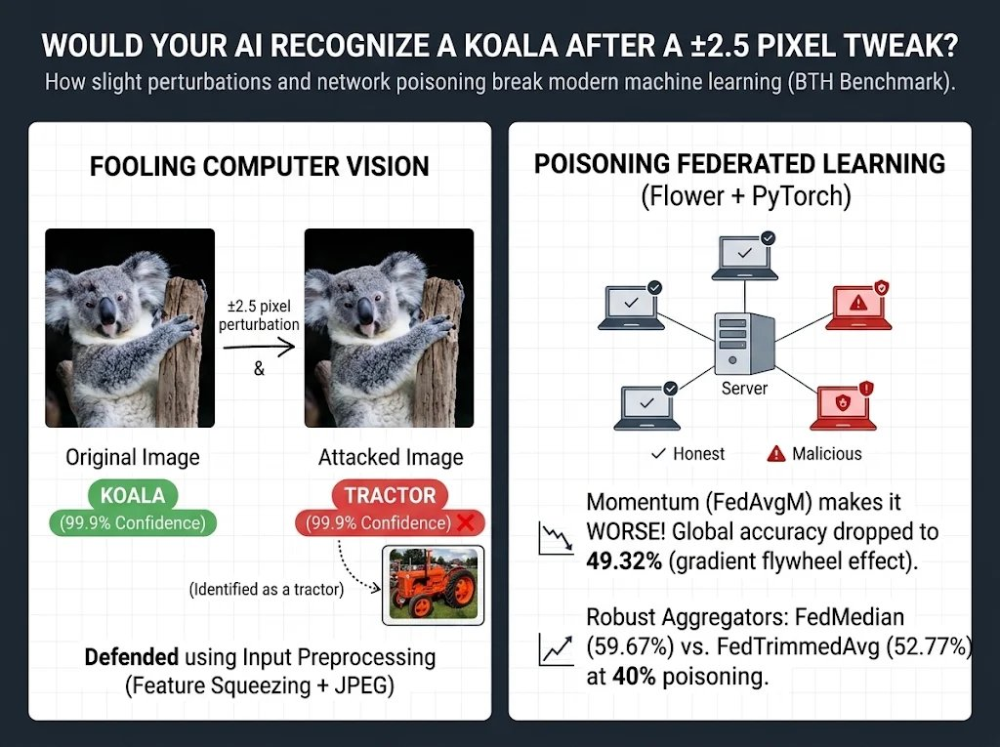
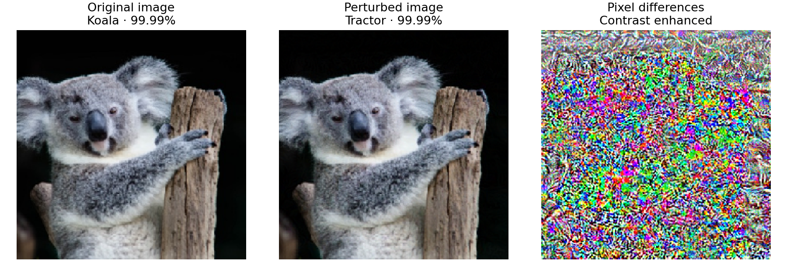
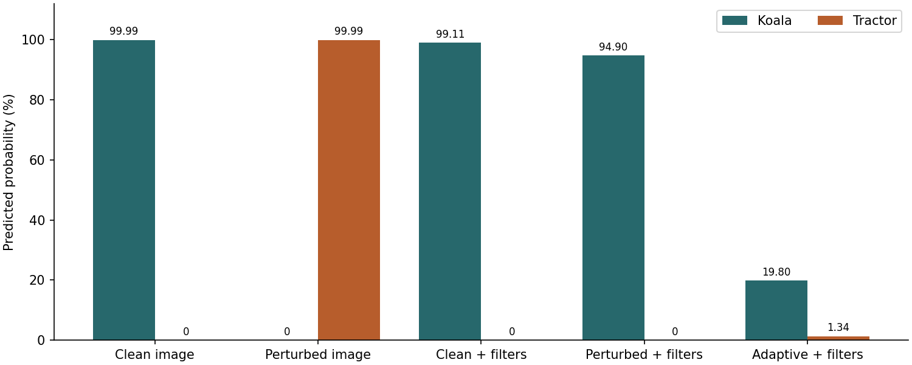
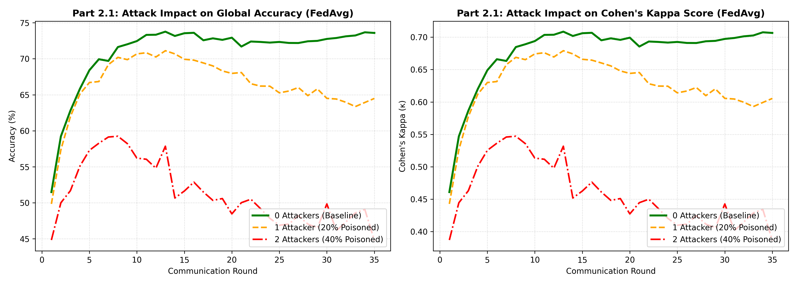
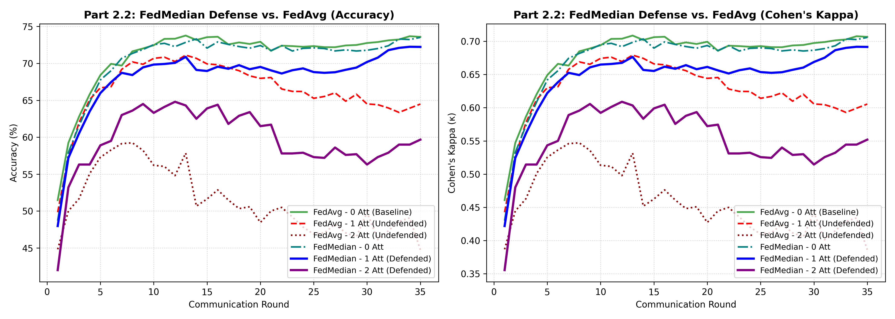
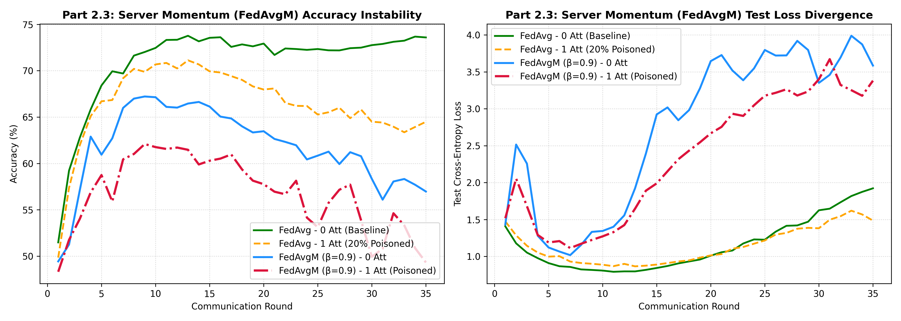
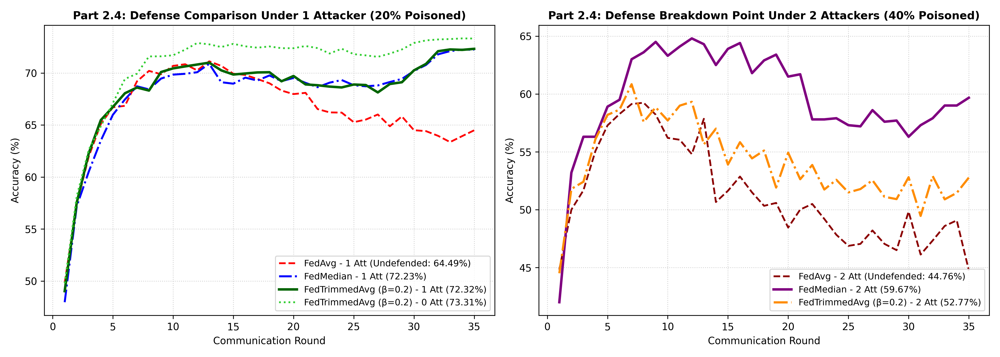

# Security in AI Systems (DV2607)



How does input preprocessing affect an image classifier's predictions under adversarial perturbation, and how well does federated learning tolerate clients with corrupted labels? **Bilal Abdul** and **Subhi Alloush** studied these questions at **Blekinge Institute of Technology (BTH)** using **ResNet-50** on ImageNet images and a **five-client Flower simulation on CIFAR-10**.

[English Report (PDF)](report/dv2607-ai-security-report.pdf) · [Image Classification Notebook](notebooks/image_classifier_robustness.ipynb) · [Federated Learning Notebook](notebooks/federated_learning_robustness.ipynb) · [Original Swedish Report (archived)](https://github.com/megarom02/Security-in-AI-systems/blob/1e5d4dfe3ab16f2a2a89d6ae9816b917f31df0b7/report/Rapport_DV2607_Bilal_Subhi.pdf)

---

## Part 1: Image Classifier Robustness (ResNet-50 + PGD)

Using IBM's Adversarial Robustness Toolbox (ART), a targeted Projected Gradient Descent (PGD) perturbation caused **ResNet-50** to misclassify a koala image as a tractor. Applying **4-bit feature squeezing** and **JPEG compression** as input preprocessing recovered the correct `koala` prediction with **94.9%** confidence, while keeping **99.1%** confidence on the clean koala image.

> **Scope note:** These measurements evaluate a single image pair (`koala.jpeg` → `tractor.jpeg`). A broader robustness estimate requires evaluating across a multi-image test set.





---

## Part 2: Federated Learning Robustness (CIFAR-10, 5 Clients)

We trained a CNN classifier for **35 federated rounds** on CIFAR-10 across five clients with equal-sized training partitions, comparing four server aggregation rules as the number of clients with corrupted (flipped) labels increased from 0 to 2.

| Aggregation Method | 0 of 5 Clients | 1 of 5 Clients | 2 of 5 Clients |
| :--- | ---: | ---: | ---: |
| Federated Averaging (`FedAvg`) | 73.59% | 64.49% | 44.76% |
| Coordinate-Wise Median (`FedMedian`) | 73.52% | 72.23% | **59.67%** |
| Server Momentum (`FedAvgM`) | 56.97% | 49.32% | — |
| Coordinate-Wise Trimmed Mean (`FedTrimmedAvg`) | 73.31% | **72.32%** | 52.77% |

- With **1 compromised client**, **Coordinate-Wise Trimmed Mean** achieved the highest accuracy (**72.32%**), closely followed by **Coordinate-Wise Median** (**72.23%**).
- With **2 compromised clients (40% poisoned)**, **Coordinate-Wise Median** retained **59.67%** accuracy—**+14.91 percentage points** above standard `FedAvg`.
- *Note:* No two-client poisoning run was reported for `FedAvgM`.









---

## Repository Structure

```text
.
├── README.md
├── LICENSE
├── requirements.txt
├── images/
│   ├── project_overview_banner.jpg
│   ├── koala.jpeg / tractor.jpeg
│   ├── part1_pgd_attack_visualization.png
│   ├── part1_defense_evaluation.png
│   └── part2_*.png
├── notebooks/
│   ├── image_classifier_robustness.ipynb      # Part 1: ResNet-50 PGD attack & preprocessing defense
│   └── federated_learning_robustness.ipynb    # Part 2: 5-client CIFAR-10 Flower simulation
└── report/
    └── dv2607-ai-security-report.pdf          # Full English report with all 11 FL runs & figures
```

## Quickstart

```bash
git clone https://github.com/megarom02/Security-in-AI-systems.git
cd Security-in-AI-systems
python3 -m venv .venv
source .venv/bin/activate
pip install -r requirements.txt
jupyter notebook notebooks/
```

- **Part 1** loads `images/koala.jpeg` and `images/tractor.jpeg` locally and downloads ImageNet ResNet-50 weights on first run (uses TensorFlow 1.x compatibility graph mode for ART).
- **Part 2** downloads CIFAR-10 automatically via `torchvision` and runs Flower simulations locally (GPU recommended for faster training).

## License

[MIT](LICENSE)
